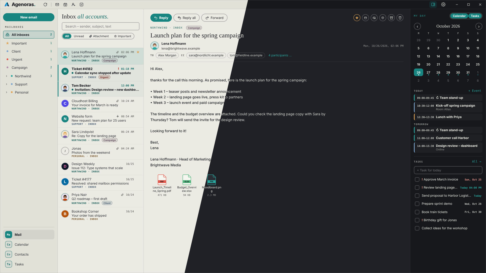
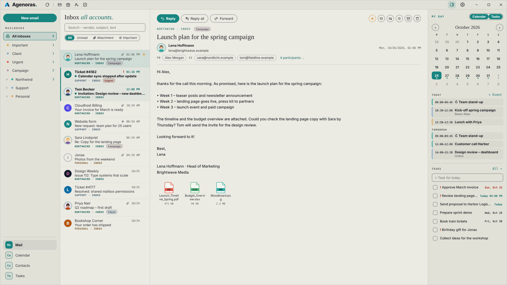
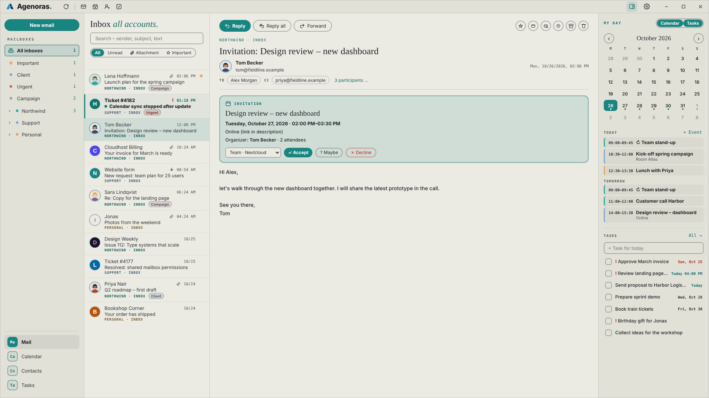
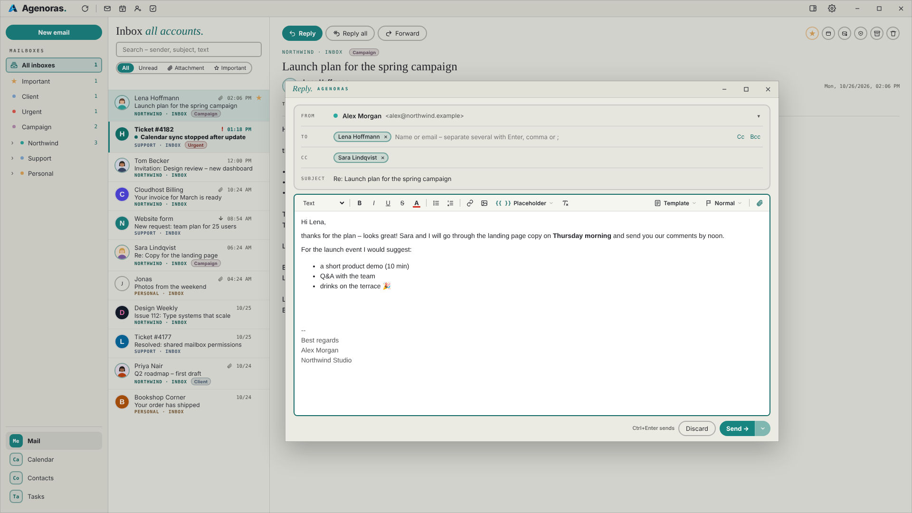
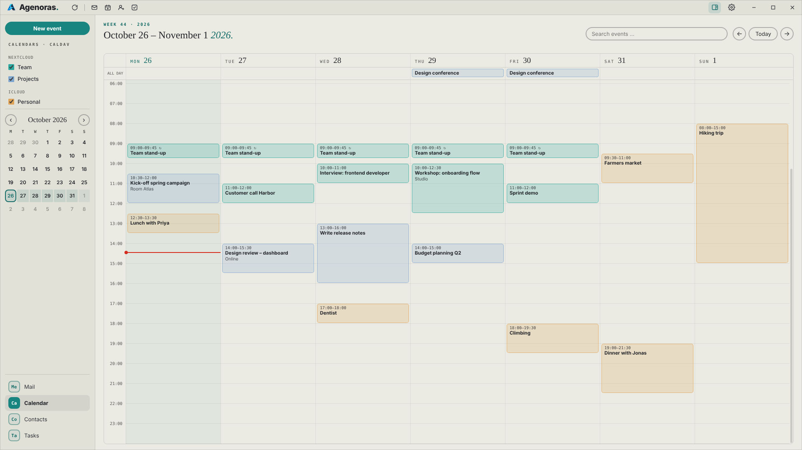
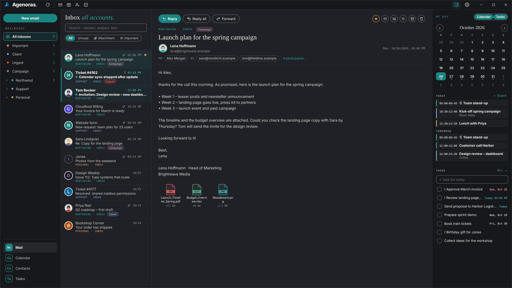
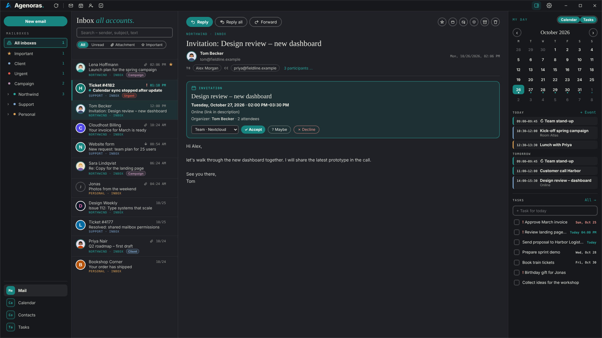
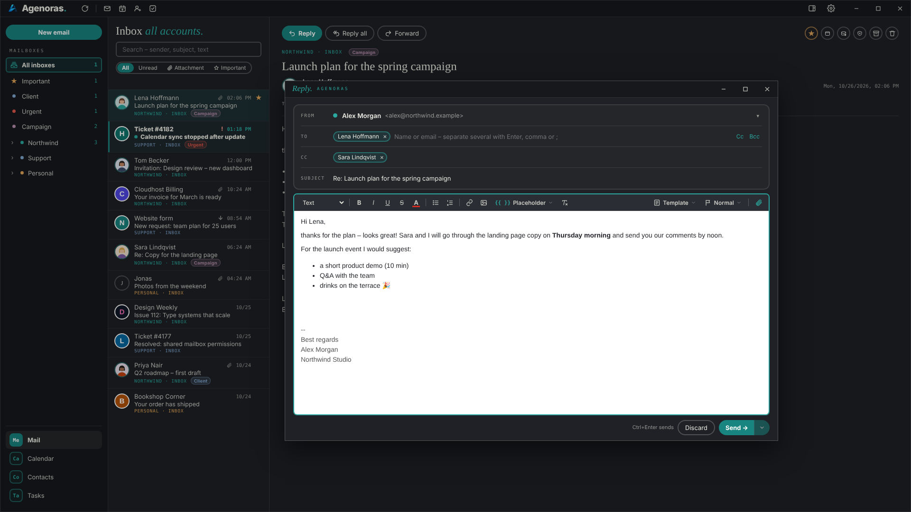
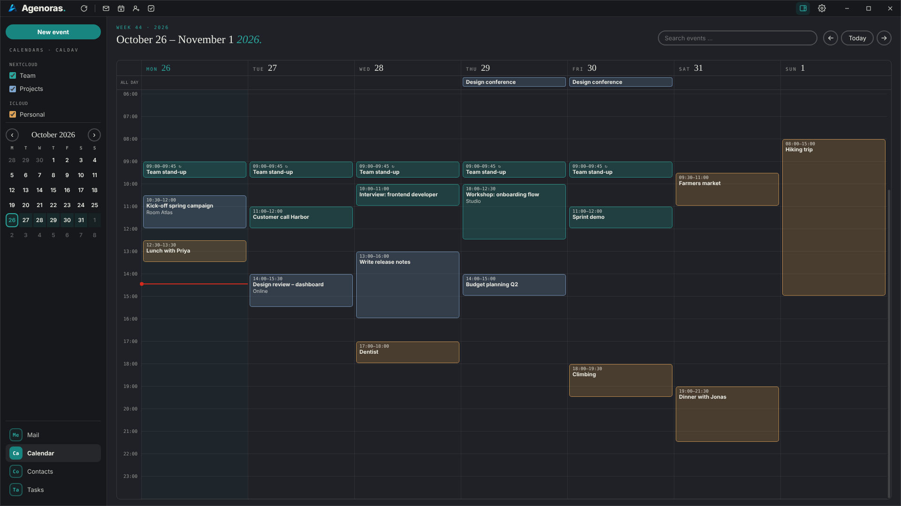

# Agenoras
Desktop mail, calendar, contacts, tasks and news feeds in one app, built by [CiegoLink](https://ciegolink.com).




Agenoras is an Electron + TypeScript client for standard protocols: IMAP or POP3 and SMTP for mail, CalDAV for calendars and tasks, CardDAV for contacts, RSS/Atom for news feeds. It works with Nextcloud, iCloud, Gmail (app password), Dovecot/Postfix hosting and most other providers. Calendars, tasks and contacts can also be kept locally without a server. An optional offline AI writes, proofreads and translates mail on your own computer. The user interface is available in German and English.

[User manual](docs/USER_MANUAL.md) · [Wiki](https://github.com/ciegolink/agenoras/wiki) · [Issues](https://github.com/ciegolink/agenoras/issues) · [ciegolink.com](https://ciegolink.com) · [agenoras.com](https://agenoras.com)

## Download

[](https://github.com/ciegolink/agenoras/releases/latest)
[](LICENSE)

| Platform | Download |
|---|---|
| Windows | [Installer (.exe)](https://github.com/ciegolink/agenoras/releases/latest/download/Agenoras-Setup.exe) · [Portable (.exe)](https://github.com/ciegolink/agenoras/releases/latest/download/Agenoras-Portable.exe) |
| Linux | [Debian/Ubuntu (.deb)](https://github.com/ciegolink/agenoras/releases/latest/download/agenoras_amd64.deb) · [AppImage](https://github.com/ciegolink/agenoras/releases/latest/download/Agenoras-x86_64.AppImage) |
| macOS | [Disk image (.dmg)](https://github.com/ciegolink/agenoras/releases/latest/download/Agenoras.dmg) · [Zip](https://github.com/ciegolink/agenoras/releases/latest/download/Agenoras-mac.zip) (Intel + Apple Silicon) |

All versions and release notes: [Releases](https://github.com/ciegolink/agenoras/releases).

- **Windows:** run the installer; SmartScreen may warn about an unknown publisher → **More info → Run anyway**.
- **Ubuntu/Debian:** `sudo apt install ./agenoras_amd64.deb`
- **AppImage:** `chmod +x Agenoras-x86_64.AppImage`, then start it.
- **macOS:** open the `.dmg` and drag Agenoras to Applications. The app is signed and notarized by Apple (universal: Apple silicon and Intel).

## Features

**Mail**
- Multiple IMAP/SMTP accounts with a unified inbox and live updates (IDLE)
- Sign in with Microsoft or Google (OAuth 2.0 with PKCE, token in the system keychain, renewed automatically) as an alternative to passwords
- POP3 accounts (SSL/TLS or STARTTLS): the inbox is fetched every 2 minutes and kept locally, optionally leaving a copy on the server
- Private accounts: hidden until unlocked with a PIN, locked again by hand or automatically after a few minutes
- A colour per account (preset or custom)
- Folder tree per account with unread counts; expand/collapse state is remembered
- Right-click on a folder: mark all as read; empty the trash; move all spam to the trash
- Conversations: replies are grouped under the newest mail and can be expanded; switched on or off per account
- Filter bar per folder: all/unread, attachments, starred, plus a quick filter by sender and subject that offers the full search when nothing matches
- Star (`\Flagged`), categories (colored labels), spam/not spam, archive, delete, drag and drop onto folders
- Ctrl+Z moves deleted, moved, archived or spam-marked mail back to its folder (new UIDs via UIDPLUS, Message-ID lookup as fallback)
- Multi-select (Ctrl/Shift+click, Ctrl+A), context menu, double-click opens a mail in its own window
- Right-click in a mail: reply, reply all, reply to a single participant, reactions, copy, translate
- Reactions (👍 ❤️ 😂 …) are sent as a short reply mail that quotes the original
- Opened mail counts as read after an adjustable delay (immediately, after 1–10 s, or only by hand)
- Rules: conditions on sender, recipient or subject; actions move, mark read, star, categorize, spam, delete. Rules also run for mail that arrived while the app was closed
- External images blocked by default, with per-mail and per-sender approval
- Optional marking of external senders (outside your own domains)
- Sender pictures from contact photos or website favicons, initials as fallback
- Desktop notifications, notification sounds per account, tray icon with background mode
- Problem log behind a warning sign in the title bar: connection and server errors only, can be copied and cleared

**Compose**
- Opens in a separate window (default) or as a fixed popup over the main window
- WYSIWYG editor with sanitized paste, inline images, links and plain-text alternative; compact icon toolbar with tooltips
- Multiple recipients in To/Cc/Bcc with suggestions from contacts and previous correspondents
- Send to all or individually to each recipient, with placeholders such as `{{FirstName}}`
- Sender identities and aliases per account, each with a text or HTML signature; compact, searchable list for many signatures
- Templates, priority, attachments by drag and drop, adjustable undo delay (0–5 s)

**Calendar and tasks**
- CalDAV week view with month overview, drag to move or resize, drag on an empty slot to create
- Recurring events with series/occurrence editing, exceptions and time zones
- Attendees and invitations by mail (iMIP): send, accept, decline, apply replies and cancellations
- Move events between calendars, send events as `.ics`, event search
- CalDAV tasks (VTODO) with due dates, priority, lists per account and a "My day" sidebar
- Local calendars and task lists without a server (stored only on this computer)

**Contacts**
- CardDAV address books with photo upload, create contacts directly from a mail
- Local address books without a server
- Multi-select (Ctrl/Shift+click, Ctrl+A) to write to several contacts at once
- Distribution lists stored only in the app (`lists.json`): add contacts by drag and drop or from the contact view, also addresses that aren't contacts; offered as a suggestion in the To field; send to all or individually to each

**Feeds**
- RSS 2.0, RSS 1.0 (RDF) and Atom; enter a feed or just a website address (the feed is discovered automatically)
- Optional login (HTTP Basic) for protected feeds, password encrypted like account passwords
- Feeds view with unread counts, all/unread filter, full-text filter, mark all read; only shown once a feed exists
- Articles cached for offline reading (up to 300 per feed), shown sanitized in the sandboxed frame, images embedded by the main process
- Refreshed when opened, with F5 and every 30 minutes

**Search**
- One search field in the title bar (Ctrl+K / Ctrl+F) for mails (full text on the server, all folders, all or one account), appointments, contacts, tasks and feed articles
- Own search page: hits by type with counts in the sidebar, mail preview on the right; × or Esc returns to the previous view

**Offline AI (optional)**
- Runs entirely on your computer with [Ministral 3 3B](https://huggingface.co/mistralai/Ministral-3-3B-Instruct-2512) by Mistral AI; no cloud, no data leaves the device
- Generate a mail text from a short description; when replying, the AI knows the original mail and answers in its language
- Suggest subject lines, proofread the text (Ctrl+Z undoes it)
- Translate selected text into a default language (right-click in a mail, or the translate button when writing)
- Output language selectable independently of the UI language (e.g. Swiss German with "ss", German, English, French, Italian)
- Enabled under Settings → AI: one-time download (about 2 GB, checked with SHA-256), about 3 GB of RAM while working, freed again after 5 minutes without use

**General**
- Local SQLite cache for fast startup and offline reading
- Same filter bar design in mail, feeds, contacts and tasks
- Light and dark theme, three font sizes, configurable week start
- Window size, position and column widths are remembered
- About dialog with version info and links (gear menu → About Agenoras)

## Getting started

Requirements: Node.js 22 or newer.

```bash
npm install
npm start
```

On first start, add an account via **Settings → Accounts**.

See [docs/DEVELOPMENT.md](docs/DEVELOPMENT.md) for a full setup guide (Ubuntu and Windows), VS Code integration, debugging and troubleshooting.

### Scripts

| Command | Description |
|---|---|
| `npm start` | Compile and start the app |
| `npm run build` | Compile TypeScript to `dist/` |
| `npm run watch` | Compile on every save |
| `npm run icons` | Generate app and tray icons from `build/logo.png` |
| `npm run dist:linux` | Build Linux packages (AppImage, .deb) into `release/` |
| `npm run dist:win` | Build Windows installer and portable `.exe` into `release/` |
| `npm run dist:mac` | Build macOS `.dmg` and `.zip` (universal: Intel + Apple Silicon), run on a Mac |

### Releases

Pushing a version tag builds Linux, Windows and macOS packages with GitHub Actions and attaches them to a draft release:

```bash
npm version patch        # or minor / major
git push --follow-tags
```

The workflow can also be started manually under **Actions → Build → Run workflow**; the packages are then available as run artifacts.

## Configuration

**Server addresses**

| Provider | Settings |
|---|---|
| Gmail | `imap.gmail.com` / `smtp.gmail.com`, use an app password |
| Nextcloud | CalDAV and CardDAV: `https://<host>/remote.php/dav` |
| iCloud | CalDAV `https://caldav.icloud.com`, CardDAV `https://contacts.icloud.com`, app password |

Microsoft 365 / Outlook.com and Gmail can also sign in with OAuth (browser sign-in, no password) once client IDs are set in `src/main/oauth.ts`, see [DEVELOPMENT.md](docs/DEVELOPMENT.md#oauth-microsoft-and-google). Google Calendar/Contacts and Microsoft calendars/contacts are not supported yet.

**Logo**

Place your own logo at `build/logo.png`. It appears in the title bar, as the window icon and in the tray. Run `npm run icons` to generate the full icon set (`build/icon.png`, `build/icons/`, `build/icon.ico`, `build/tray*.png`).

**Sounds**

Notification sounds go into `sounds/`. See [sounds/README.md](sounds/README.md).

**Environment variables**

| Variable | Effect |
|---|---|
| `AGENORAS_LANG=en` | Force a UI language |
| `AGENORAS_WAYLAND=1` | Use native Wayland instead of XWayland (Linux) |
| `AGENORAS_GPU=1` | Enable hardware acceleration (disabled by default on Linux) |

## Data and security

User data is stored in `~/.config/agenoras/` (Linux), `%APPDATA%\agenoras\` (Windows) or `~/Library/Application Support/agenoras/` (macOS):

- `accounts.json`, `calendars.json`, `contacts.json`: accounts; passwords are encrypted with the OS keychain via Electron `safeStorage`; PINs of private accounts are stored only as a salted scrypt hash
- `settings.json`: identities, signatures, templates, rules, preferences
- `lists.json`: distribution lists – exist only on this computer, include them in your backup
- `rss.json`: feeds (password encrypted like the accounts)
- `cache.db`: local cache (mail, feed articles and their read state), safe to delete at any time; feed articles are fetched again on the next refresh
- `pop3.db`: mail of POP3 accounts – the only copy if the server copy is deleted, include it in your backup
- `local.db`: local calendars, tasks and address books – the only copy, include it in your backup
- `ai.json`, `ai-models/`: AI settings and the downloaded model (delete the model under Settings → AI)

Data from earlier versions (folder `ciegolink-mail`) is copied over automatically on first start; the old folder can be deleted afterwards.

HTML mail and feed articles are rendered in a sandboxed frame without scripts under a strict Content Security Policy. Remote content is fetched only by the main process: for mail only on request, for feed articles automatically when an article is opened.

While a private account is locked it does not appear anywhere (no mails, search hits or notifications), and its locally cached mail is removed. After a restart, every private account starts locked.

The AI model runs locally in a separate process (`utilityProcess`). Texts are processed only on this computer and never sent anywhere; the only network access of the AI is the one-time download of the model file.

## Project structure

```
├─ lang/                 UI strings (de.json, en.json; English is the fallback)
├─ build/                App and tray icons
├─ scripts/make-icons.js Icon generator
├─ sounds/               Notification sounds
└─ src/
   ├─ main/              Electron main process
   │  ├─ main.ts         Windows, tray, notifications, IPC
   │  ├─ preload.ts      window.api bridge for the renderer
   │  ├─ imap.ts         IMAP connection, IDLE, folders, mail operations
   │  ├─ pop3.ts         POP3 accounts: local store, fetching
   │  ├─ pop3client.ts   POP3 protocol client (TLS / STLS)
   │  ├─ mailparse.ts    Parsing raw mail into summaries and details
   │  ├─ smtp.ts         Sending, attachments, individual sending
   │  ├─ caldav.ts       Calendars, events, recurrence (ical.js)
   │  ├─ invites.ts      Meeting invitations (iMIP)
   │  ├─ tasks.ts        CalDAV tasks (VTODO)
   │  ├─ carddav.ts      Address books, vCards
   │  ├─ lists.ts        Distribution lists (lists.json)
   │  ├─ rss.ts          RSS/Atom feeds: storage, fetching, parsing, article cache
   │  ├─ localdav.ts     Local calendars and address books (no server)
   │  ├─ rules.ts        Mail rules
   │  ├─ cache.ts        SQLite cache (node:sqlite)
   │  ├─ log.ts          Problem log (errors only)
   │  ├─ ai.ts           Offline AI: model download, settings, request queue
   │  ├─ aiworker.ts     AI worker process (node-llama-cpp)
   │  ├─ remote.ts       Favicons, external images, HTML signatures
   │  ├─ settings.ts     Identities, signatures, templates, preferences
   │  ├─ accounts.ts     Mail accounts
   │  ├─ oauth.ts        Sign-in with Microsoft and Google (OAuth)
   │  ├─ davaccounts.ts  CalDAV/CardDAV accounts
   │  ├─ sounds.ts       Notification sounds
   │  ├─ winstate.ts     Window state
   │  └─ i18n.ts         Language selection
   └─ renderer/          UI (no Node access)
      ├─ index.html      Main window
      ├─ compose.html    Compose window
      ├─ mailview.html   Mail in its own window
      ├─ styles.css
      ├─ common.ts       Shared helpers, i18n, HTML sanitizer
      ├─ renderer.ts     Mail view, search page
      ├─ reader.ts       Mail display (reading pane and mail window)
      ├─ compose.ts      Editor, recipients, attachments, sending
      ├─ compose-ai.ts   AI in the compose window: text, subject, proofread, translate
      ├─ calendar.ts     Calendar view
      ├─ tasks.ts        Task view
      ├─ contacts.ts     Contacts view, multi-select
      ├─ lists.ts        Distribution lists: sidebar, dialog, drag and drop
      ├─ rss.ts          Feeds view, add/edit feed dialog
      ├─ agenda.ts       "My day" sidebar
      ├─ labels.ts       Categories
      ├─ problems.ts     Problem log dialog
      ├─ settings.ts     Settings dialog
      └─ types.d.ts
```
### Screenshots

| Home | Settings | Compose | Calendar |
|:---:|:---:|:---:|:---:|
|  |  |  |  |
|  |  |  |  |

## Translations

UI strings live in `lang/<code>.json`. The app uses the system language if a file exists for it, otherwise English. To add a language, copy `lang/en.json` (for example to `lang/fr.json`) and translate it; missing keys fall back to English. Template placeholders work in both languages (`{{Vorname}}` = `{{FirstName}}`).

## Tech stack

[Electron](https://www.electronjs.org/), TypeScript, [ImapFlow](https://github.com/postalsys/imapflow), [Nodemailer](https://nodemailer.com/), [mailparser](https://github.com/nodemailer/mailparser), [tsdav](https://github.com/natelindev/tsdav), [ical.js](https://github.com/kewisch/ical.js), [xml-js](https://github.com/nashwaan/xml-js), `node:sqlite`, [node-llama-cpp](https://github.com/withcatai/node-llama-cpp).

The optional offline AI uses [Ministral 3 3B Instruct](https://huggingface.co/mistralai/Ministral-3-3B-Instruct-2512) © Mistral AI, licensed under the [Apache License 2.0](https://www.apache.org/licenses/LICENSE-2.0) (GGUF quantization by [bartowski](https://huggingface.co/bartowski/mistralai_Ministral-3-3B-Instruct-2512-GGUF)). The model is not part of the app; it is downloaded on request and verified with SHA-256.

## License

[MIT](LICENSE) © 2026 CiegoLink GmbH